  

Создаю сайты и веб-приложения для бизнеса, развиваю собственные продукты. В работе использую JavaScript, Git и AI-ассистентов — от формулировки задачи до проверки изменений.

### Проекты

**[WordFlow](https://github.com/0w1Max/WordFlow)** — веб-приложение для изучения слов с интервальным повторением.  
`JavaScript` · `Node.js` · `Express` · `SQLite`  
[Открыть приложение](https://word-flow-nine.vercel.app) · [Исходный код](https://github.com/0w1Max/WordFlow)

**Voqelis** — собственная платформа для работы с речью, заметками, задачами и автоматизацией.  
`Python` · `Telegram` · `SQLite` · `AI-assisted development`  
*Активная разработка · репозиторий приватный*

**[Сайт психолога](https://olgakuzhbatherapy.ru/)** — коммерческий веб-проект для частного специалиста.  
`Next.js` · `React` · `TypeScript` · `Tailwind CSS`  
*Исходный код приватный*

### Технологии

**Основные:** `JavaScript` · `HTML` · `CSS` · `Git` · `Joomla` · `OpenCart`  
**Проектная практика:** `React` · `TypeScript` · `Node.js` · `REST API` · `SQL` · `Docker`  
**Инструменты ИИ:** `ChatGPT` · `Codex`

### Контакты

[Telegram @Ow1Max](https://t.me/Ow1Max)
