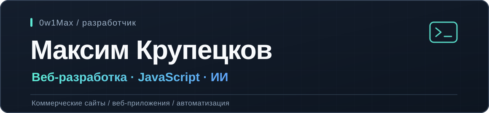

  

### Проекты

**[WordFlow](https://github.com/0w1Max/WordFlow)** — приложение для изучения слов с интервальным повторением. JavaScript, Node.js, Express, SQLite. [Открыть демо](https://word-flow-nine.vercel.app).

**Voqelis** — собственная платформа для распознавания речи, планирования и автоматизации. Python, Telegram, SQLite, AI-assisted разработка. Исходный код приватный.

**[Сайт психолога](https://olgakuzhbatherapy.ru/)** — коммерческий веб-проект на Next.js, React и TypeScript. Исходный код приватный.

### Технологии

`JavaScript` · `HTML/CSS` · `Node.js` · `Git` · `React / TypeScript` (проектная практика) · `ChatGPT / Codex`

### Контакты

[Telegram @Ow1Max](https://t.me/Ow1Max)
