<h1 align="center">Maxim · Frontend / Web Developer</h1>

  Разрабатываю сайты, веб-приложения и собственные цифровые продукты — от интерфейса до API и развёртывания.

  <strong>JavaScript · TypeScript · React · Next.js · Node.js · Python</strong>

---

### 🎮 Commando Activity

  

  Пустынный каньон · фиксированная 8-bit локация · календарь и цели обновляются автоматически дважды в сутки

Авторская SVG-игра на основе реальной активности GitHub: боец бегает, прыгает и стреляет по клеткам календаря. **Новые учитываемые вклады меняют игровое поле**, а выбранная локация остаётся постоянной.

**Технологии:** `JavaScript` · `SVG` · `GitHub Actions` · [Код генератора](https://github.com/0w1Max/0w1Max/tree/main/scripts)

---

### Обо мне

Занимаюсь веб-разработкой: создаю интерфейсы, сайты для бизнеса, веб-сервисы и инструменты автоматизации. За плечами **более 10 сайтов и веб-проектов**, включая коммерческие заказы, интернет-магазины и дальнейшее сопровождение проектов.

Работал с **Joomla и OpenCart**; сейчас основной интерес — **Frontend на JavaScript/TypeScript и React**, разработка полнофункциональных веб-приложений и интеграция сервисов.

### Технологии и инструменты

| Направление | С чем работаю |
| :-- | :-- |
| **Frontend** | HTML5, CSS3, JavaScript, TypeScript, React, Next.js, Tailwind CSS |
| **Backend и API** | Node.js, Express, Python, FastAPI, REST API |
| **Данные** | SQLite, SQL, Turso |
| **CMS и коммерческие сайты** | Joomla, OpenCart, поддержка и доработка сайтов |
| **Разработка и развёртывание** | Git, GitHub Actions, Docker, Linux, Vercel |
| **AI-инструменты** | ChatGPT, Codex, Claude — для разработки, анализа и проверки решений |

**Основные направления:** адаптивные веб-интерфейсы · веб-приложения и API · автоматизация · Telegram Mini Apps · интеграция AI-функциональности.

---

### Избранные проекты

#### 01 · [Сайт психолога](https://olgakuzhbatherapy.ru/)

Коммерческий сайт для частного специалиста. Проект веб-разработки с акцентом на удобный интерфейс и адаптацию под разные экраны.

**Стек:** `Next.js` · `React` · `TypeScript` · `Tailwind CSS`  
[Открыть сайт](https://olgakuzhbatherapy.ru/) · *Исходный код приватный*

#### 02 · [WordFlow](https://github.com/0w1Max/WordFlow)

Веб-приложение для изучения и запоминания слов с интервальными повторениями. Работа с пользовательскими данными, авторизация и серверная логика.

**Стек:** `JavaScript` · `Node.js` · `Express` · `Turso / SQLite`  
[Открыть приложение](https://word-flow-nine.vercel.app/) · [Исходный код](https://github.com/0w1Max/WordFlow)

#### 03 · Voqelis

Собственная платформа для обработки речи и автоматизации: Telegram-бот, локальное распознавание голосовых сообщений, работа с текстом, заметками и задачами. Развиваю также веб-интерфейс в формате Telegram Mini App.

**Стек:** `Python` · `FastAPI` · `React / TypeScript` · `SQLite` · `Telegram` · `ASR`  
*Активная разработка · исходный код приватный*

---

### Подход к разработке

Стараюсь разбирать задачу от требований до работающего результата: продумываю структуру проекта, пишу и проверяю код, тестирую изменения и занимаюсь развёртыванием. Использую AI-инструменты как часть рабочего процесса, но уделяю отдельное внимание проверке полученного результата.

### Связаться со мной

**Telegram:** [@Ow1Max](https://t.me/Ow1Max)  
**GitHub:** [github.com/0w1Max](https://github.com/0w1Max)

Здесь — избранные работы и технологии без полной хронологии трудоустройства. Подробное резюме можно предоставить отдельно.
