[English](README.md) · [Русский](README.ru.md)

<h1 align="center">Krupetskov Maksim</h1>

<strong>Веб-разработчик · Frontend-разработчик</strong>

  

## Технологии

### Frontend

<code>HTML</code>&nbsp; &nbsp;
<code>CSS</code>&nbsp; &nbsp;
<code>JavaScript</code>&nbsp; &nbsp;
<code>TypeScript</code>&nbsp; &nbsp;
<code>React</code>&nbsp; &nbsp;
<code>Next.js</code>&nbsp; &nbsp;
<code>Vite</code>&nbsp;

### Backend

<code>Node.js</code>&nbsp; &nbsp;
<code>Next.js</code>&nbsp; &nbsp;
<code>Express</code>&nbsp; &nbsp;
<code>Python</code>&nbsp; &nbsp;
<code>FastAPI</code>&nbsp;

### APIs

<code>REST API</code>&nbsp; &nbsp;
<code>Telegram Bot API</code>&nbsp; &nbsp;
<code>Telegram WebApp SDK</code>&nbsp; &nbsp;
<code>Cloudflare</code>&nbsp;

### Databases

<code>SQL</code>&nbsp; &nbsp;
<code>SQLite</code>&nbsp; &nbsp;
<code>PostgreSQL</code>&nbsp; &nbsp;
<code>Prisma ORM</code>&nbsp; &nbsp;
<code>Turso</code>&nbsp;

### Tools

<code>Git</code>&nbsp; &nbsp;
<code>GitHub</code>&nbsp; &nbsp;
<code>Docker</code>&nbsp; &nbsp;
<code>Nginx</code>&nbsp; &nbsp;
<code>Vercel</code>&nbsp; &nbsp;
<code>Playwright</code>&nbsp;

### CMS / Commerce

<code>Joomla</code>&nbsp; &nbsp;
<code>OpenCart</code>&nbsp; &nbsp;
<code>WordPress</code>&nbsp;

### AI Development

<code>ChatGPT</code>&nbsp; &nbsp;
<code>Codex</code>&nbsp; &nbsp;
<code>Claude</code>&nbsp;

## Проекты

**01 / [Therapist Website — Full-Stack Web Application](https://olgakuzhbatherapy.ru/)**  
Full-stack веб-приложение для клинического психолога: адаптивный сайт, блог, административная панель, формы консультаций, PostgreSQL и интеграция с Telegram.  
`Next.js` · `React` · `TypeScript` · `Tailwind CSS` · `PostgreSQL` · `Prisma ORM` · `Docker` · [Открыть сайт](https://olgakuzhbatherapy.ru/) · [Описание проекта](projects/therapist-website.md) · *Закрытый исходный код*

**02 / [WordFlow](https://github.com/0w1Max/WordFlow)**  
Веб-приложение для изучения слов с интервальными повторениями, авторизацией, серверной логикой и постоянным хранением данных.  
`JavaScript` · `Node.js` · `Express` · `Turso / SQLite` · *В разработке* · [Демо](https://word-flow-nine.vercel.app/) · [Исходный код](https://github.com/0w1Max/WordFlow)

**03 / [Voqelis — AI Assistant & Telegram Mini App](projects/voqelis.md)**  
Платформа продуктивности на собственном сервере: локальное распознавание русской речи, интеллектуальное планирование и несколько LLM-провайдеров. Telegram Mini App на React/TypeScript включает настраиваемые сценарии, восстанавливаемые черновики, просмотр и экспорт DOCX/PDF.  
`React` · `TypeScript` · `Vite` · `Python` · `FastAPI` · `SQLite` · `GigaAM` · `Playwright` · [Описание проекта](projects/voqelis.md) · *В разработке · Закрытый исходный код*

## Опыт

Создал и сопровождал более 10 сайтов, включая коммерческие проекты и интернет-магазины. Опыт работы с CMS, электронной коммерцией, поддержкой сайтов и самостоятельной разработкой веб-приложений. Здесь представлены избранные проекты.

## Контакты

**[Telegram](https://t.me/Ow1Max)** · **[GitHub](https://github.com/0w1Max)**
